# StreamSnip - Lossless HLS & Direct Media Video Clipper

[](LICENSE)
[](package.json)
[](tests/)
[](CONTRIBUTING.md)

**Snip before you download.** StreamSnip is a standalone Google Chrome Extension (Manifest V3) that sniffs HLS (`.m3u8`) and direct media streams, probes duration and metadata, provides a full-featured Video.js player tab for scrubbing and lossless sub-second trimming, and processes downloads asynchronously in the background via Chrome Offscreen documents - without re-encoding a single frame.

---

## Why StreamSnip?

| Scenario                                  | Typical Downloaders                                     | StreamSnip                                            |
| :---------------------------------------- | :------------------------------------------------------ | :---------------------------------------------------- |
| **Download a 30s clip from a 2hr stream** | Forces downloading all 2 hours (4+ GB)                  | Downloads only the requested 30s (~20 MB)             |
| **Trimming Precision**                    | Coarse 5-10s segment boundaries, or slow WASM re-encode | Sub-second accuracy, zero re-encode, instant save     |
| **Background Processing**                 | Closing popup or side panel kills the download          | Chrome Offscreen worker runs uninterrupted            |
| **Stream Health & Metadata**              | Blindly lists broken or dead URLs                       | Auto-probes duration/resolution and filters dead URLs |
| **Disguised / Image-Wrapped Streams**     | Fails with corrupted files or "no media found"          | Auto-detects and strips fake PNG headers in memory    |
| **macOS QuickTime & iOS Playback**        | Glitches or refuses to open fragmented fMP4             | 100% compatible progressive MP4 with unified `moov`   |
| **Audio-Only Export**                     | Requires external video converter software              | 1-click sample-accurate MP3 export via Web Audio      |
| **Privacy & Security**                    | May route streams through cloud servers                 | 100% client-side, zero cloud proxies, zero telemetry  |

---

## Key Features

- **Lossless Zero-Reencode Fine Trimming**: Employs container-level ISO/IEC 14496-12 Edit Lists (`edts`/`elst`) and sample pruning. Video hardware decoders skip directly to your exact start timecode without re-encoding keyframes, preserving 100% source resolution and bitrate.
- **Dedicated Video.js Player with Clipping Controls**: Opens streams in a dedicated, high-performance player tab (`player/player.html`) with interactive scrubbing, hotkey clipping (`[` for Start, `]` for End, `Space` for Play/Pause), quality variant switching, and live duration display.
- **Persistent Background Offscreen Worker**: Segment fetching, stego stripping, and transmuxing execute in a dedicated Chrome Offscreen Document (`offscreen/offscreen.html`). Closing the popup or side panel does not interrupt downloads.
- **Automated Stream Probing & Health Filter**: Probes detected streams in the background to calculate duration, resolution, and segment count. Automatically filters out dead streams (HTTP 4xx/5xx, CORS-blocked, or unparseable manifests) before presenting them in the UI.
- **Robust Sniffer & Catcher**: Multi-strategy detection catching streams via URL patterns, MIME `Content-Type`, `Content-Disposition` attachment headers, and Chrome's internal media request types. Groups streams by domain with instant search.
- **In-Flight Steganography Stripping**: Transparently detects disguised HLS segments (such as MPEG-TS packets prepended with fake 8-byte PNG image headers) and recovers raw sync bytes (`0x47`) in real time.
- **Progressive MP4 Unfragmenting**: Reconstructs fragmented MP4 streams (`moof` + `mdat`) into classic progressive files with complete sample tables (`stts`, `stss`, `ctts`, `stsz`, `stsc`, `stco`) for flawless compatibility with macOS QuickTime Player, iOS, and desktop video editors.
- **Frame-Accurate MP3 Extraction**: Decodes audio tracks directly in the browser, slices raw Float32 PCM channels to your exact millisecond boundaries, and encodes to MP3 via `lamejs`.
- **Decoupled 3-Tab UI**: Clean side panel interface featuring:
  - **Videos**: Sniffed streams with duration badges, resolution, manual URL input, and one-click launch into the player.
  - **Downloads**: Active progress cards, download speed, cancel controls, and system file manager integration.
  - **Settings**: Sniffer file size thresholds, concurrency limit, extension reload shortcut, and live diagnostic terminal.

---

## Architecture & Data Flow

The end-to-end processing pipeline runs strictly inside your local browser sandbox:

```mermaid
flowchart TD
    %% ==========================================
    %% 1. CAPTURE & DISCOVERY
    %% ==========================================
    subgraph Step1 ["1. Sniff & Discovery"]
        Host["Host Webpage\n(Network Traffic & Media Tags)"]
        SW["Service Worker & Catcher\n(background/catcher.js)"]
        Host -->|"webRequest & Headers"| SW
    end

    %% ==========================================
    %% 2. PROBE & STREAM SELECTION
    %% ==========================================
    subgraph Step2 ["2. Probe & Filter"]
        Fetcher["StreamFetcher (lib/stream-fetcher.js)\n- Validates M3U8 / Media Headers\n- Extracts Duration & Resolution\n- Drops Broken (4xx/5xx/CORS) URLs"]
        Popup["Videos Tab (popup/stream-list.js)\n(Domain Groups, Search & Duration Badges)"]
        SW --> Fetcher
        Fetcher -->|"Verified Streams"| Popup
    end

    %% ==========================================
    %% 3. VIDEO.JS PLAYER & CLIPPING
    %% ==========================================
    subgraph Step3 ["3. Playback & In/Out Range Selection"]
        Player["Dedicated Player Tab (player/player.html)\n- Video.js + Hls.js Playback Engine\n- Hotkeys: [ Start, ] End, Space\n- Timeline Planner (Timeline.getClipPlan)"]
        Popup -->|"Open in Player"| Player
    end

    %% ==========================================
    %% 4. OFFSCREEN BACKGROUND DOWNLOAD
    %% ==========================================
    subgraph Step4 ["4. Background Processing (Offscreen Document)"]
        Offscreen["Offscreen Worker (offscreen/offscreen.js)\n(Survives Popup & Side Panel Closure)"]
        FetchPool["Concurrent Segment Downloader (4x Pool)"]
        Strip["Stego Stripper (Removes Fake PNG Headers)"]
        Remux["Transmuxer (lib/transmuxer.js)\n- TS to Progressive MP4\n- Injects ISO edts/elst Edit List\n- Or Web Audio to Frame-Accurate MP3"]

        Player -->|"START_DOWNLOAD Task"| Offscreen
        Offscreen --> FetchPool
        FetchPool --> Strip
        Strip --> Remux
    end

    %% ==========================================
    %% 5. DELIVERY & MANAGEMENT
    %% ==========================================
    subgraph Step5 ["5. Delivery & History"]
        Save["chrome.downloads API\n(Sanitized Filename with Range Suffix)"]
        DownloadsTab["Downloads Tab (popup/downloads-manager.js)\n(Live Progress Cards & Finder Reveal)"]
        Remux --> Save
        Save --> DownloadsTab
    end
```



---

## Project Structure

```
stream-snip/
├── background/
│   ├── catcher.js            # Sniffed stream registry, domain grouping, and tab preservation
│   └── service_worker.js     # Chrome webRequest interceptor, context menus, and offscreen coordinator
├── content/
│   └── content.js            # Webpage script observing video elements and reporting streams
├── lib/
│   ├── bytes.js              # High-performance typed array buffer concatenation
│   ├── constants.js          # Shared message types, storage keys, and safety bounds
│   ├── downloader.js         # Concurrent segment fetcher and worker pool
│   ├── mp3-encoder.js        # Web Audio PCM channel slicer and lamejs MP3 encoder
│   ├── parser.js             # M3U8 playlist parser and Timeline.getClipPlan
│   ├── stego-loader.js       # Hls.js fragment loader adapter
│   ├── stego.js              # Binary inspection and PNG header stripper
│   ├── stream-fetcher.js     # Stream duration/resolution probing and dead link filter
│   ├── stream-sniffer.js     # URL pattern, MIME, and Content-Disposition classifiers
│   ├── time.js               # Timestamp parsing, formatting, and filename generation
│   ├── transmuxer.js         # TS-to-MP4 transmuxer, edts/elst builder, and unfragmenter
│   └── videojs/              # Bundled offline Video.js distribution and styles
├── offscreen/
│   ├── offscreen.html        # Manifest V3 offscreen document container
│   └── offscreen.js          # Background download worker and progress dispatcher
├── player/
│   ├── player.css            # Video.js player layout, clipper panel, and controls
│   ├── player.html           # Standalone player page with quality and download toolbar
│   └── player.js             # Player coordinator, keyboard shortcuts, and clipping logic
├── popup/
│   ├── downloads-manager.js  # Download progress cards, status updates, and history tracking
│   ├── popup.css             # Side panel styling, dark theme, and status badges
│   ├── popup.html            # Side panel entry point with 3-tab layout
│   ├── popup.js              # Lightweight tab switcher and lifecycle coordinator
│   ├── settings.js           # Sniffer thresholds, extension reboot, and diagnostic terminal
│   ├── stream-list.js        # Domain-grouped stream cards, probe badges, and search
│   └── ui-feedback.js        # Non-blocking inline notifications and toast messages
├── tests/                    # Comprehensive unit and integration test suite (124 tests)
├── types/
│   └── domain.d.ts           # Strict TypeScript ambient types and domain contracts
├── jsconfig.json             # TypeScript checkJs configuration
└── manifest.json             # Manifest V3 extension configuration
```

---

## Installation in Google Chrome

### From Source (Developer Mode)

1. Clone this repository:
   ```bash
   git clone https://github.com/dev-ansung/stream-snip.git
   ```
2. Open Google Chrome and go to `chrome://extensions`.
3. Toggle on **Developer mode** in the top-right corner.
4. Click **Load unpacked** in the top-left corner.
5. Select the `stego-clip-extension` directory.

### From Release Package

1. Download the latest `stream-snip-v*.zip` from GitHub Releases.
2. Unzip the package into a local directory.
3. In `chrome://extensions` with **Developer mode** enabled, click **Load unpacked** and select the unzipped folder.

---

## Usage

1. **Sniff Streams**:
   - Open any webpage playing an HLS (`.m3u8`) or direct video/audio stream.
   - Click the **StreamSnip** icon in your toolbar or open the Chrome Side Panel.
   - Sniffed streams appear grouped by website domain with probed duration, resolution, and segment count.
2. **Launch Player**:
   - Click **▶️ Open Player** on any stream card to open the dedicated player tab (`player/player.html`).
3. **Clip Time Range**:
   - Scrub the video or press `Space` to play/pause.
   - Press `[` (or click **[ Start**) to set the clip start time.
   - Press `]` (or click **] End**) to set the clip end time.
   - You can also type exact timestamps (`MM:SS` or `HH:MM:SS`) directly into the inputs.
4. **Download**:
   - Choose your desired format (`MP4`, `TS`, or `MP3`).
   - Click **⬇️ Download Clip** (or press `Enter`).
   - The download task is dispatched to the background offscreen worker.
5. **Monitor Progress**:
   - Switch to the **Downloads** tab in the side panel to view real-time download progress, transfer speed, and completion status.
   - Closing the side panel or popup will **not** interrupt background downloads.

---

## Development & Verification

StreamSnip enforces strict multi-tier verification including TypeScript `checkJs` type checking, ESLint, Prettier, and automated tests.

Install dependencies:

```bash
pnpm install
```

Run type checking:

```bash
pnpm run typecheck
```

Run the unit test suite (124 tests):

```bash
pnpm test
```

Run the complete presubmit verification gate (Typecheck + Lint + Prettier Check + Tests):

```bash
pnpm run check
```

Automatically format code style:

```bash
pnpm run format
```

Build a standalone distribution ZIP for release:

```bash
pnpm run build
```

---

## Contributing

Contributions are welcome! Please check out [CONTRIBUTING.md](CONTRIBUTING.md) for guidelines on code style, testing, and pull requests.

---

## License

This project is licensed under the MIT License - see the [LICENSE](LICENSE) file for details.
